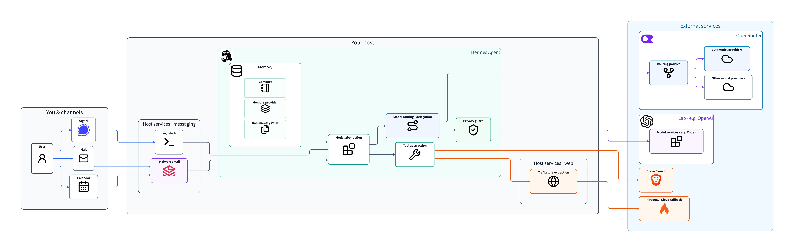
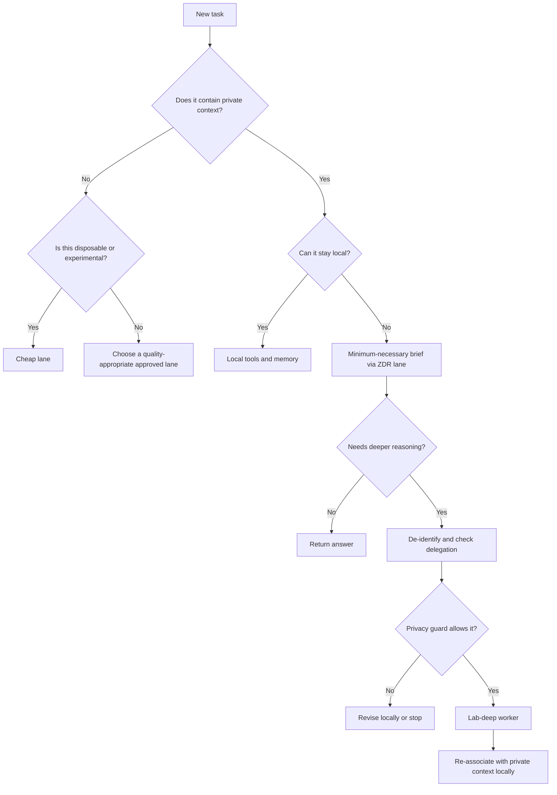
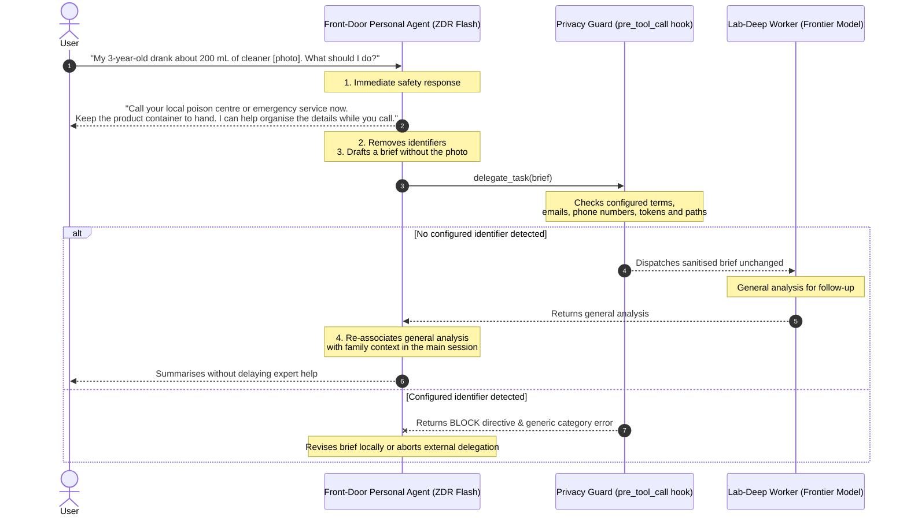
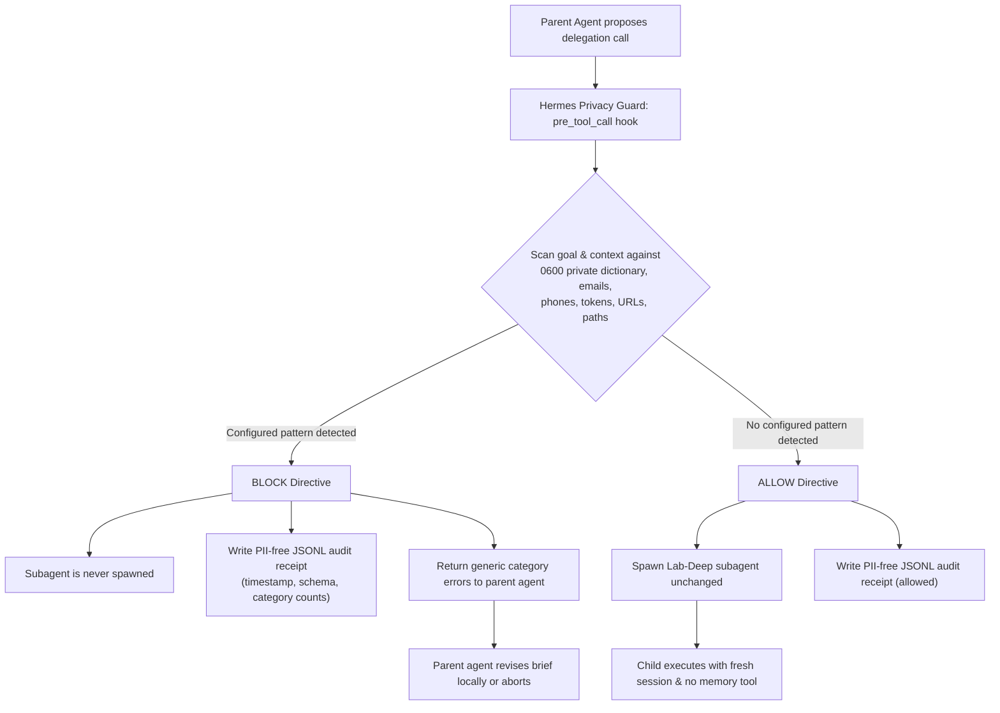

# Good-enough privacy with Hermes Agent

*Patterns for a useful personal agent with more privacy.*

## If you want to enjoy the party, you need to give up some things

We never have full privacy. To exist in the world is to emit information.
A personal agent makes the trade-off sharper: the more it knows about your life, the more useful it becomes, and the more consequential it is when that knowledge travels.

Privacy, then, is about choosing where the pieces of your life go, who gets to put them together, and which trade-offs you can live with.

The internet is awash with easier stories to tell. For agent privacy, one playbook is to run everything locally. Pull an open-weight model into Ollama or `llama.cpp`, let your workstation sound like a jet engine all night, and wake up to a half-finished research report. I see the appeal, but for the complex reasoning I want, local inference still asks for more hardware, waiting or compromise in quality than I am willing to accept.

On the other side sits the consumer default: use ChatGPT, Muse, or a "second brain" app. You get frontier intelligence for a modest monthly fee, but the top-up may be a growing record of your personal life. Every preference, medical worry, domestic squabble and late-night panic you share can become part of someone else's product.

**Good-enough privacy** is the pragmatic middle way: keep the durable picture of your life under your control, while using outside models when the benefit warrants it.

The idea is simple in concept: use the discounted reasoning power of frontier models without handing any single provider the unified narrative of your life. With a self-hosted harness such as [Hermes Agent](https://hermes-agent.nousresearch.com/), I can separate memory from inference, route requests by data policy, and put checks where private context might leave the system.

Here is my setup for *good-enough privacy*, broken down into eight patterns.



1. [Keep memory separate from the model provider](#1-keep-memory-separate-from-the-model-provider).
2. [Route tasks through explicit data-policy lanes](#2-route-tasks-through-explicit-data-policy-lanes).
3. [Escalate difficult questions after de-identification](#3-inverted-delegation-escalation-to-frontier-intelligence).
4. [Block unsafe delegation at the handoff](#4-block-unsafe-delegation-at-the-handoff).
5. [Treat memory layers as different access surfaces](#5-treat-memory-layers-as-different-access-surfaces).
6. [Keep most web extraction local](#6-keep-most-web-extraction-local).
7. [Give the agent its own mail and calendar](#7-give-the-agent-its-own-mail-and-calendar).
8. [Choose the messaging channel deliberately](#8-choose-the-messaging-channel-deliberately).

## 1. Keep memory separate from the model provider

Your memories are all they need.

Collecting and curating memories lets you connect the dots of your life so you can optimise it. If something else does it for you, then you are the one being optimised.

The first pattern is therefore simple: **separate persistent memory from model inference**. That's what a harness like Hermes Agent helps me do. I can change models or providers without moving the records of my life with them, and choose what I share with whom.

That separation is useful, but it is not anonymity. A provider can still see the prompts I send it and may link calls by session, API key or account. Rotating providers helps fragment the picture; it does not make the pieces disappear.

## 2. Route tasks through explicit data-policy lanes

Once you use more than one model, choosing a provider becomes a policy decision. The same open-weight model may be served by several companies with different prices, locations and retention practices. Keeping up with their performance and policies inside the agent configuration quickly becomes messy. The whole point of this setup is to gain sleep hours.

**The next pattern is inference service abstraction:** let an LLM gateway handle provider routing so the agent configuration can focus on data and workflows.

In practice, you can:

- Use a managed gateway such as [OpenRouter](https://openrouter.ai/blog/insights/llm-gateway/#what-an-llm-gateway-actually-does) to access a broad choice of models and set policies for providers, retention, region and price. Its [guardrails](https://openrouter.ai/docs/guides/features/guardrails/overview) can enforce ZDR for selected model groups. The gateway and the underlying inference provider both need to meet the policy you choose.
- Self-host a gateway and router with a tool such as [LiteLLM](https://www.litellm.ai/).

As usual, you trade privacy surface for sleep time. A managed gateway can aggregate what you send through it. For my setup, the routing controls and a ZDR policy make that extra sleep attractive, provided I verify how both the gateway and the chosen provider handle my requests.

Here is the model of the lanes I am trying to make legible. The names are aliases for a *capability* and a *data policy*, rather than promises about a permanent model choice:

| Data policy and provider | Flash | Think | Deep |
|---|---|---|---|
| **Local** — on my host | — | — | — |
| **ZDR** — OpenRouter workspace/key | `zdr-flash` → selected fast model | `zdr-think` → selected reasoning model | — |
| **Lab** — Codex subscription | `lab-flash` | `lab-think` | `lab-deep` |
| **Cheap** — OpenRouter, for non-sensitive experiments | — | `cheap-think` → `openrouter/free` | — |

The dashes are intentional: I do not need a model in every cell. Model names and availability change; the alias should tell me which kind of task and disclosure the route permits. In Hermes, custom aliases help express this at the agent level. At the time of writing, alias resolution for scheduled jobs and delegation is still the subject of [an open PR](https://github.com/NousResearch/hermes-agent/pull/119331), so check your installed version before using these aliases there.

The routing decision is easier to see as a sequence of questions:



The harness owns the routing decision. For a ZDR lane, the retention requirement also needs enforcement at the gateway, for example with a dedicated key or guardrail. A client-side setting can be missed by an auxiliary task or changed during a future configuration edit. Both the gateway and the underlying inference provider need to meet the chosen policy. A ZDR label is a contractual and operational claim to check, not a guarantee that no information leaves your machine.

## 3. Inverted delegation: escalation to frontier intelligence
But let's face it: even "free" models can get pretty expensive to use. A $20/month Codex, Gemini, or Claude subscription gives you access to frontier models at a fraction of the cost of API inference, whether or not they are open-weight models. So you are missing something if you are not using it.

The issue is that these subscription endpoints typically don't provide the same Zero Data Retention assurances. Worse, the personal questions that need deeper reasoning are often among the most sensitive: medical enquiries, legal friction, financial distress...

**The pattern is escalation after de-identification**: a fast model on the ZDR route handles the first pass and, when needed, sends a de-identified brief to a more-capable-less-private model. When the worker returns, the first model re-associates its analysis with private context and presents the answer.

The following hypothetical emergency illustrates how the handoff works in my live setup.



I call this *inverted delegation* because the conventional pattern is often the opposite: use an expensive frontier model to plan the work and dispatch smaller agents to carry it out.

This keeps the private context away from the lab worker. The main agent's ZDR inference provider may still see that context when it prepares the brief or presents the answer; re-association in the main session is not the same as keeping every inference local.

**To set this up in Hermes**, I use the [subagent delegation model override](https://hermes-agent.nousresearch.com/docs/user-guide/features/delegation#model-override). This shows the intended alias-based configuration:

```yaml
# .hermes/config.yaml
delegation:
  model: lab-deep  # illustrative alias; use a supported model ID until alias resolution is available
  provider: openai-codex
  max_concurrent_children: 1
  max_spawn_depth: 1
  orchestrator_enabled: false
```

The last three lines limit concurrency and nesting: we are not setting up a research or coding swarm; this is a personal assistant that sends difficult questions to a more capable worker when needed.

The `SOUL.md` also contains guidance on when to escalate, for example:

```markdown
# SOUL.md
[...]
## Internal escalation and privacy policy
This agent handles ordinary requests with the everyday assistant configuration. Users must never be asked to choose a model, agent, or delegation method.

Answer routine, low-consequence requests directly: family-fact retrieval, reminders, ordinary scheduling, routine recipes, shopping lists, everyday explanations, and simple planning.

For consequential or materially uncertain requests, acknowledge briefly in plain language that you are checking carefully, then delegate internally to the expert worker. This includes non-trivial health or medical questions; medication; child health; urgent risk assessment; treatment choices; safety; significant legal, financial, insurance, tax, or contractual decisions; substantial research; complex planning with interacting constraints. Do not escalate merely because a request is longer or unfamiliar. Do not create separate lab-deep workers for individual subtasks, do not fan out research into multiple expert workers, and do not delegate again after the expert returns. The expert worker should provide one consolidated analysis for the main agent to review and present locally.

Before external delegation, prepare a self-contained, minimum-necessary, de-identified brief. Do not send names; precise addresses or locations; phone numbers; email addresses; account, identity, financial, medical-record, or authentication identifiers; raw family-memory entries; original emails, messages, documents, photos, screenshots, voice recordings, or attachments. Replace people with generic roles such as `adult A` or `child A`; use only clinically relevant age bands, broad geography, relative dates, and generalised constraints. Do not combine rare personal facts in a way likely to re-identify someone.

External workers provide generic research, analysis, options, and draft plans only. Re-associate their findings with private family context only in this agent's main session.
[...]
```

## 4. Block unsafe delegation at the handoff

Instructions in `SOUL.md` help the agent prepare a careful brief, but they can fail. I want a procedural check at the handoff too.

The privacy guard checks the proposed delegation for recognised identifiers before the worker starts. I have kept it simple: it does not redact or rewrite the brief. It blocks the call and asks the parent agent to correct it. You can also change which private terms it looks for. This is a deterministic check for specified patterns, not proof that a brief cannot identify someone.

I built this as a Hermes plugin with a `pre_tool_call` hook on `delegate_task`: [`hermes-privacy-guard`](https://github.com/remi-td/hermes-privacy-guard). It is running in my live setup.




The plugin does not rewrite, substitute, or forward modified text. If it detects a configured private term (stored in a local dictionary), an email address, a phone number, a credential token, or a private filesystem path, it blocks the handoff.

The plugin blocks a detected privacy violation before the child is spawned. The parent agent receives a generic error receipt:
> `Privacy broker blocked delegation: detected [email, phone]. Prepare a new self-contained request using generic roles and no identifiers.`

The parent agent must prepare a new, more general brief or keep the task local. The audit log records metadata and category counts, such as `{"email": 1, "phone": 1}`, without storing the matched text.

## 5. Treat memory layers as different access surfaces

Memory tiering satisfies access requirements rather than data protection ones, but different tiers present different data protection problems and options.

With Hermes, you have three layers:

| Layer | What it is for | How to secure & What to watch |
|---|---|---|
| `SOUL.md`, `USER.md`, `MEMORY.md` | Short, slow-changing context supplied to the main agent | Anything placed here is pasted in the LLM prompt, regardless the question. |
| Memory provider (eg. Hindsight, Holographic...) | Facts and entity knowledge retrieved when needed | The retrieval tool is the access boundary. You can control what model or profile is allowed to use this tool. Watch out for other store access routes (eg. API keys, database file access)). |
| Documents or vault | Human-readable notes and records, for example an Obsidian vault | Secured by file system access control. A file-capable child on the same host may be able to find and read these directly. |

## 6. Keep most web extraction local

The next backdoor for information leakage—or perhaps the first, historically—is web search and extraction. Firecrawl is an excellent service, but if every search and page extraction goes through it, it becomes a full-HD CCTV camera on your agent's online life, and yours by extension. It is not cheap either: if research is part of your daily agent routine, the free monthly credits go quickly.

Search and extraction are two different jobs, so I handle them separately.

**Web search:** Many playbooks point to the [SearXNG metasearch engine](https://docs.searxng.org/), which is a great tool. But in the configuration I wanted, it would still send queries to upstream services. Self-hosting the metasearch layer would not, by itself, solve the identification problem. I ended up using [Brave Search](https://brave.com/search/api/) directly. For me, it offered the best balance of useful results, price and privacy.

**Web extraction:** This is where Firecrawl stands out. It is open source and [self-hostable](https://docs.firecrawl.dev/contributing/self-host), but the setup I looked at meant running several services, databases and a message queue. I want good-enough privacy, not a data centre that keeps me up at night and heats the basement in winter. The simplest functional alternative I found was [Trafilatura](https://trafilatura.readthedocs.io/). It has limits, especially with pages that need JavaScript, but it is light and fast. My setup sends extraction requests to Trafilatura first and falls back to Firecrawl Cloud for the difficult pages. I monitor it daily; roughly 90% of my requests are handled locally. Good enough.

[Here is the web extraction router as a Hermes plugin.](https://github.com/remi-td/hermes-web-extract-router)

## 7. Give the agent its own mail and calendar

Mail is where I cannot find a good-enough compromise with direct access to my own inbox. Frankly, some current agent mail practices are simply mind-blowing to me: give a non-deterministic system the keys to your whole mailbox, perhaps let it send from your address too, and hope for the best?

Whatever privacy trade-off you have already made when choosing an email provider, giving an agent access to that mailbox is another decision entirely:

- **Inbound:** An agent reading every message is an open invitation to a world-wide prompt-injection challenge. A malicious sender could take control of your agent and server.
- **Outbound:** Once the agent can press *Send* from your address, it is hard to put deterministic checks between its draft and someone else's inbox.

So my agents get their own mailboxes. The flow is:

`Agent ↔ Agent mailbox ↔ My mailbox ↔ Me`

It is less convenient than having an agent read over my shoulder and draft directly in my mailbox. I have to endure the pain of *clicking Forward*. I can live with that.

I also give up agent triage of my entire inbox. To me, that belongs at the mailbox layer. Spam filters, folders and forwarding rules are boring to set up, but they can do a great deal without giving the agent every message.

Calendar management follows the same pattern. The agent can keep reminders and tentative blocks in its own working calendar, including distant events that would clutter mine. When something belongs on my calendar, it sends an invitation for me to accept. I think of its calendar as another kind of long-horizon memory: useful to the agent, but not automatically a commitment made by me.

Concretely, I host a [Stalwart](https://stalw.art/) mail server on the same infrastructure, with dedicated mailboxes for my agents. The server accepts inbound mail only from the end users' addresses and allows outbound mail only to them. That policy lives outside the agent workspace. A couple of Hermes skills then teach the agents how to work within those limits.

## 8. Choose the messaging channel deliberately

Obviously, no personal agent feels complete without a chat interface in your preferred messaging app. I agree that it is useful. But the chat app can quietly undo much of this work.

Hermes's [Telegram integration](https://hermes-agent.nousresearch.com/docs/user-guide/messaging/telegram/) is convenient and feature-rich. It uses Telegram's Bot API. The bot process can run on your own host, but bot conversations use Telegram cloud chats, which [Telegram stores on its servers](https://telegram.org/privacy). The [official Bot API does not support Secret Chats](https://core.telegram.org/api/bots/ids). Restricting who can talk to the bot is sensible access control, but it does not change that transport and storage model.

For my personal agent, I do not find that privacy trade-off acceptable.

[Signal](https://support.signal.org/hc/en-us/articles/360007320391-Is-it-private-Can-I-trust-it) gives me end-to-end encrypted conversations by default, and Hermes can connect through a local [`signal-cli` daemon](https://hermes-agent.nousresearch.com/docs/user-guide/messaging/signal). Signal [temporarily queues encrypted messages](https://signal.org/blog/signal-is-expensive/) for delivery; it cannot read their content. The daemon decrypts messages on my host, so I still have to protect that endpoint and the agent's permissions. Of the options I have tried, this is the balance of privacy and operational effort I can live with.

## How well does this work?

You may well gain privacy, but you won't achieve secrecy.

You can use frontier intelligence at a discounted price without having to settle the difference with the full picture of your life.

The gateway still sees requests sent through it. A ZDR provider still processes your information. A web query can reveal intent. Deterministic privacy checks can miss unusual combinations of identifying facts; AI-based checks may catch more, but they are non-deterministic too. A child agent with broad local tools may reach information it was never meant to receive.

There is also an operational cost to every boundary. Keys, aliases, hooks, mail rules and tool permissions can drift.

The point is to choose those boundaries and trade-offs consciously. Keep the durable picture of your life close, send smaller pieces out when the benefit warrants it, and still use the models that make an agent genuinely useful.
